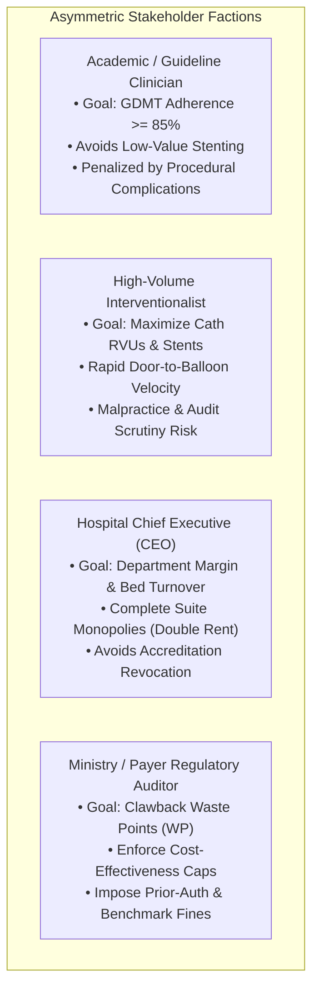
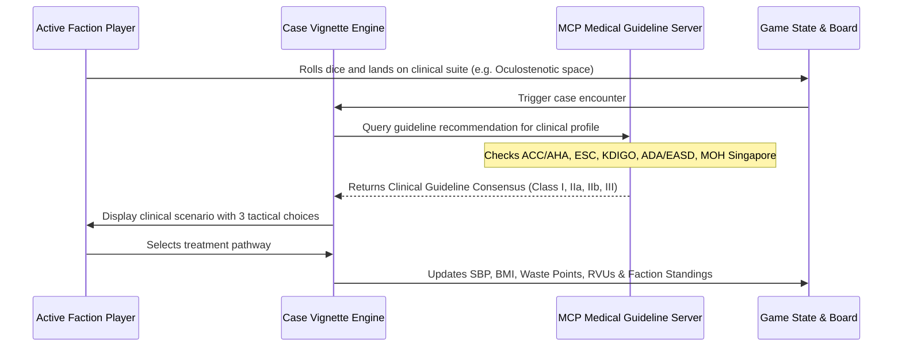
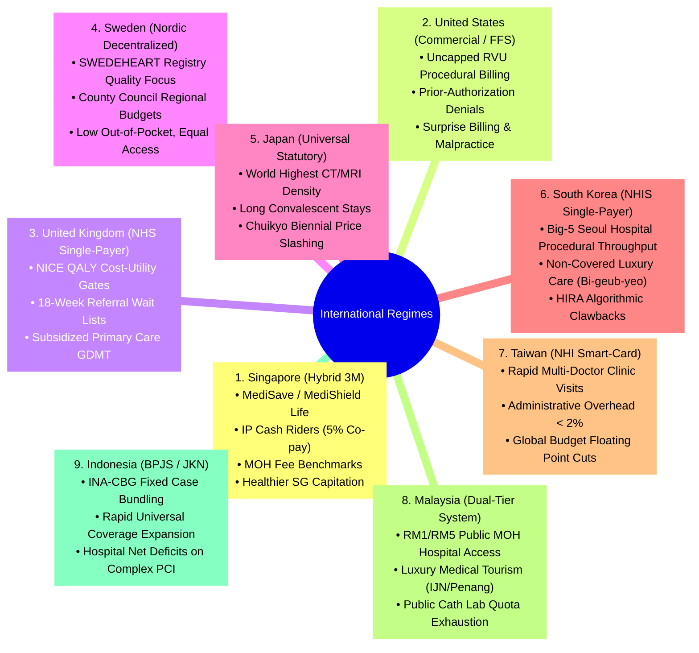
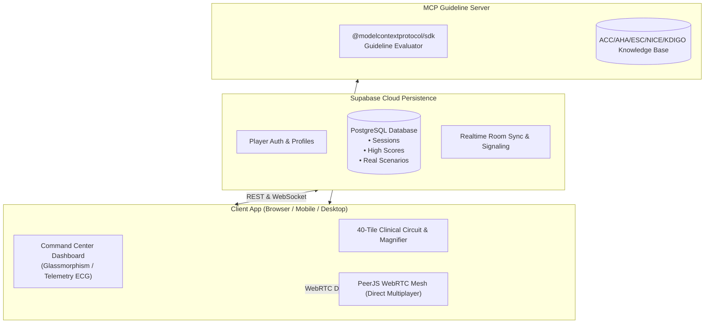

# Cardiopoly Remastered — Architecture & Design Specification

**Document Version:** 1.0  
**Date:** 2026-10-25  
**Status:** Approved  
**Author:** Pair Programming Team (Antigravity & Lead Clinician)

---

## 1. Executive Summary & Vision

**Cardiopoly** is an interactive, satirical, and clinically authentic healthcare simulation game. Originally created as an inverted Monopoly parody revolving around escalating cardiovascular neglect and waste points, this remaster elevates the game into a **multi-stakeholder clinical decision strategy simulation**.

Players navigate the real-world tensions between:
1. **Best Evidence-Based Patient Care** (Guideline-Directed Medical Therapy [GDMT], lifestyle intervention, Appropriate Use Criteria [AUC]).
2. **Pharma & Device Commercial Incentives** (high-margin procedural tariffs, stent deployments, proprietary injectables, robotic amortization).
3. **Ministry of Health, Hospital Administration, & Regulatory Scrutiny** (DRG bundling, prior-authorization denials, claims audits, bed turnover pressures).
4. **International Healthcare System Archetypes** (benchmarked across 9 national health regimes: Singapore, US, UK, Sweden, Japan, South Korea, Taiwan, Malaysia, Indonesia).

---

## 2. Core Game Systems & Asymmetric Factions

Players (human or AI bots) select or are assigned one of four asymmetric stakeholder factions, each operating with distinct economic incentives, operational levers, and victory metrics.

### Faction Scoring & Victory Conditions

| Faction | Primary Win Condition | Key Gameplay Mechanics | Vulnerability |
| :--- | :--- | :--- | :--- |
| **Academic Clinician** | **Guideline Excellence**: Reach GDMT score $\ge 85\%$ across 15 patient encounters without causing iatrogenic harm. | Earns grants and prestige points when adhering to Class I guideline recommendations; can order cross-specialty consults. | Slow revenue generation; vulnerable to hospital budget cuts. |
| **High-Volume Interventionalist** | **RVU Titan**: Reach 12,000 Procedure RVUs / Billing Points before being sanctioned. | Bypasses observation beds directly to the Cath Lab; deploys multiple stents in unindicated lesions for massive immediate gains. | Fined heavily if landed on by the Ministry Auditor or if contrast nephropathy strikes. |
| **Hospital Administrator** | **Institutional Monolith**: Own 4 full clinical department groups with hospital solvency $\ge \$10\text{M}$ net margin. | Collects double rent/facility fees on full color suites; upgrades departments to add high-tech equipment (e.g. 3D Echo, Robotic Cath). | Suffers catastrophic fines if hospital bed occupancy exceeds 100% or M&M audit flags negligence. |
| **Ministry / Payer Auditor** | **Regulatory Stewardship**: Claw back 15,000 Waste Points (WP) and maintain national healthcare sustainability. | Deploys Prior-Authorization hurdles; flags unindicated stents for 5% co-pay rejection; audits fee benchmark outliers. | Can be sued for patient harm caused by delayed prior-authorization denials. |

---

## 3. Clinical Vignette Engine & Model Context Protocol (MCP)

Instead of passive rent transactions, landing on any clinical department triggers an **Interactive Clinical Case Encounter**.

### The 3-Way Tactical Encounter Structure
Every clinical vignette presents a standardized tri-path dilemma:
1. **Option A: Guideline-Directed Medical Therapy (GDMT)**
   * Evidence-based pharmacological titration (e.g., quadruple therapy for HFrEF, high-intensity statin + ezetimibe + SGLT2i).
   * *Impact*: High Academic Clinician score, stabilizes patient SBP/BMI, low procedural billing.
2. **Option B: High-Margin Procedural Intervention**
   * Rapid stenting, atherectomy, TAVR, or ablation.
   * *Impact*: High Interventionalist RVUs and Hospital Facility Fees; increases procedure waste points; risks acute kidney injury or restenosis.
3. **Option C: Ministry Cost-Containment / Defensive Observation**
   * 23-hour observation stay, non-invasive stress imaging, or outpatient lifestyle prescription.
   * *Impact*: Satisfies hospital bed-turnover quotas, minimal direct cost, but carries risk of delayed diagnosis or readmission penalty.

### Cross-Disciplinary Interplay
* **Nephrology (Cardiorenal Synergy)**: Coronary angiograms in patients with pre-existing CKD (eGFR $< 45\text{ mL/min/1.73m}^2$) require contrast sparing protocols or Nephrology clearance. Failure risks Dialysis Penalties.
* **Endocrinology (Cardiometabolic Management)**: In patients with diabetes and ASCVD, initiating GLP-1RA and SGLT2i improves long-term survival and lowers BMI, but strains hospital pharmacy drug budgets under capped DRGs.
* **Cardiothoracic Surgery (The Heart Team)**: Complex multivessel coronary disease or left main stenosis triggers a Heart Team consensus tile: CABG vs. Multi-vessel PCI.

---

## 4. The 9-Nation Healthcare Policy Matrix

A global policy engine dynamically modifies board billing codes, reimbursement multipliers, and audit strictness based on the active national health regime.

---

## 5. System Architecture & Technical Specifications

### 1. Modern Clinical Command Center (UI/UX)
* **Glassmorphic Medical Aesthetics**: Deep slate/navy background (`#0b1120`), frosted glass panels (`backdrop-filter: blur(12px)`), neon cyan (`#06b6d4`), and emerald green (`#10b981`) telemetry highlights.
* **Animated Physiological Telemetry**: Live canvas/SVG arterial blood pressure (ABP) and ECG tracing displaying actual player SBP and heart rate.
* **Responsive Layout**: Seamless mobile-first vertical stack and adaptive desktop command center.
* **Pacing & Fluidity**: Token movement tuned to 250–350ms per tile step; non-blocking toast notifications for routine bot turns; modals reserved exclusively for critical clinical dilemmas and milestones.

### 2. Networking & Realtime Multiplayer
* **P2P WebRTC (PeerJS)**: Direct browser-to-browser data channels for turn sync, dice rolls, and trade negotiations with minimal latency and zero ongoing server hosting costs.
* **Supabase Cloud Persistence**:
  * PostgreSQL database storing user profiles, multiplayer game histories, case decision logs, and global leaderboards.
  * Realtime Broadcast channels used as the signaling broker to coordinate matchmaking lobbies.

### 3. Model Context Protocol (MCP) Medical Bridge
* Standardized MCP server exposing:
  * `evaluate_guideline_indication(case, treatment)`: Returns Class I, IIa, IIb, or III (Harm) classification with clinical trial citations (e.g. ISCHEMIA, ORBITA-2, DAPA-HF, PARADISE-MI).
  * `generate_clinical_vignette(department, regime, complexity)`: Generates real-world clinical cases with patient vitals, ECG findings, and cross-specialty labs.
  * `benchmark_international_tariff(procedure, country)`: Computes reimbursement, co-payment, and audit risks according to the host country's fee schedule.

---

## 6. Testing, Quality Assurance & Verification Plan

1. **Unit & Logic Tests**:
   * Faction victory conditions and metric calculations (SBP, BMI, Waste Points, GDMT score, RVUs).
   * International regime tariff multipliers and audit penalty calculations.
   * CSV parser resilience for clinical cards, milestones, and property datasets.
2. **Multiplayer Sync Tests**:
   * P2P state consistency verification (ensuring identical board state across connected peers).
   * Turn timeout and automatic player disconnection handling.
3. **Visual & Screenshot Verification**:
   * Automated headless screenshot capture across mobile (375x812) and desktop (1440x900) viewports to verify UI layout integrity, text wrapping, and dialog state resets.
4. **Clinical Accuracy Review**:
   * Verification of case scenarios and guidelines against ACC/AHA 2023, ESC 2024, KDIGO 2023, and MOH Singapore clinical practice benchmarks.

---

## 7. Immediate Bug Fixes Completed

* **Trade UI Reset Bug ([`script.js`](file:///C:/Users/lauye/Downloads/cardiopoly/script.js#L1638-L1647))**:
  * *Root Cause*: `resetGameToRules()` previously targeted obsolete element IDs (`#trade-proposal-card` and `#trade-create-card`).
  * *Fix*: Corrected DOM references to `#trade-response-actions`, `#trade-creator-form`, and `#trade-status-msg`, ensuring all trade dialogues and buttons properly clear upon game reset.
